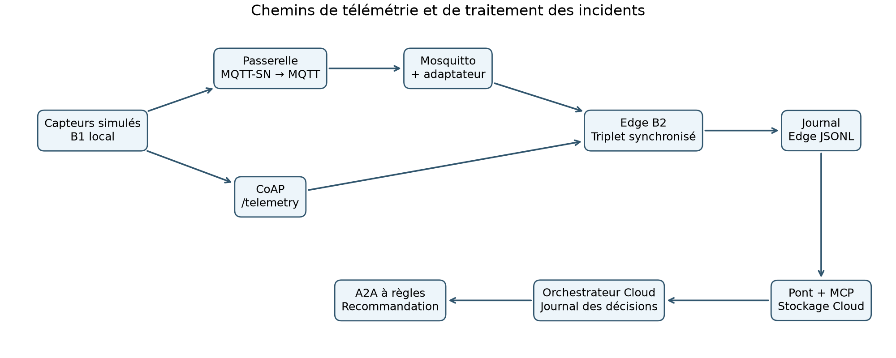
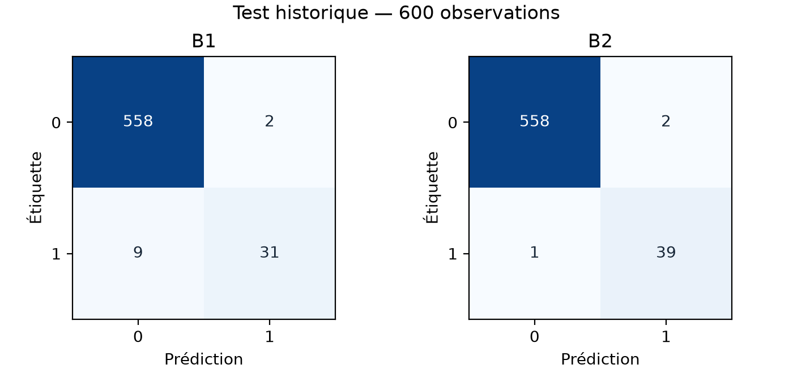
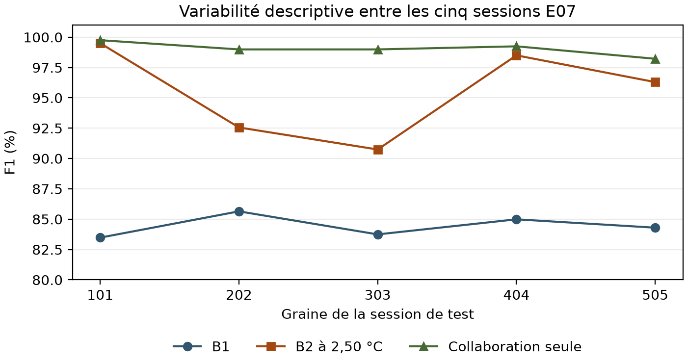

# E09–E10 — Rapport, démonstration et livraison

## Architecture et responsabilités

**Figure 1.** Les dispositifs simulés calculent B1 et envoient leurs
mesures soit par la passerelle MQTT-SN (UDP 10000) et Mosquitto (TCP 1883),
soit par CoAP (UDP 5683). Les deux entrées de télémétrie regroupent les
mesures à l’Edge par session et itération. CoAP `/alert` peut journaliser
un signalement directement. Un pont lit le journal Edge, appelle un outil
MCP sur HTTP (8000), puis l’orchestrateur Cloud transmet l’incident à A2A
sur JSON-RPC (9000). Le journal Cloud conserve `cloud_incident_id` et le
journal de décisions conserve la jointure vers l’incident Edge. Le serveur
TCP historique est hors du parcours évalué.

## Algorithmes

~~~text
B1 — Dispositif
  prédiction locale ← arbre de profondeur maximale 3(température, vibration)
  si prédiction locale = 1, envoyer une alerte locale dans la télémétrie

B2 — Edge
  accepter une mesure valide par capteur et par (session, itération)
  journaliser immédiatement une alerte B1 reçue
  si le lot expire avant trois capteurs distincts, clore le lot
  sinon, pour un lot complet :
    référence ← médiane des trois températures
    pour chaque mesure i :
      collaboration_i ← abs(température_i - référence) > 2,50 °C
      B2_i ← (prédiction locale_i = 1) OU collaboration_i
      si collaboration_i et capteur i encore actif dans sa session :
        journaliser SENSOR_INCONSISTENCY et isoler logiquement i

B3 — Cloud
  transmettre l’incident Edge au stockage MCP
  pour chaque incident Cloud sans décision enregistrée :
    appeler A2A avec l’identifiant Cloud
    appliquer rule_based_v1 au motif et retourner une recommandation
    vérifier la correspondance d’identifiant avant d’écrire la décision
~~~

Un écart de 2,50 °C exactement ne déclenche aucune alerte collaborative.
Les mesures valides des capteurs déjà isolés participent au calcul
scientifique B2. B3 opère sur des incidents et ne modifie pas la
classification. L’isolation reste logique dans ce prototype logiciel.

## Méthodologie et figures

Le protocole historique sépare 3 000 observations synthétiques en
2 400 observations de développement et 600 de test par itération et
scénario. L’étude du seuil divise les 2 400 observations en 1 920
d’entraînement et 480 de validation. Le seuil de 2,50 °C est choisi sur
validation. La comparaison finale utilise le même fichier de prédictions
B1, issu de l’arbre entraîné sur 2 400 observations, pour B1 et B2. Le
F1 de validation du seuil et le F1 sur test proviennent donc de procédures
d’entraînement distinctes. La [validation E07](experimental_protocol.md)
réserve des sessions distinctes à l’entraînement, au réglage et au test.

**Figure 2.** Matrices de confusion sur les 600 observations historiques.
Les lignes sont réelles, les colonnes prédites, et 1 désigne la classe
anomalie. B1 obtient 84,93 % de F1 et B2 96,30 %. La graine historique
est 42. Le cas `synthetic-seed-42 / 132 / node-03` reste sous le seuil,
avec un écart de 2,422 °C.

| Scénario historique | Observations | Anomalies détectées B1 → B2 | Faux positifs B1 → B2 |
|---|---:|---:|---:|
| Normal | 420 | 0 → 0 | 0 → 0 |
| Variation commune | 60 | 0 → 0 | 2 → 2 |
| Anomalie locale | 60 | 20/20 → 20/20 | 0 → 0 |
| Anomalie contextuelle | 60 | 11/20 → 19/20 | 0 → 0 |

**Figure 3.** F1 des cinq sessions laissées au test dans E07. Les
segments relient les points pour faciliter la lecture. L’ordre des
graines ne représente aucun axe temporel. Les dispersions sont
descriptives car les ensembles d’entraînement se recouvrent.

| Mesure du rejeu B3 | Résultat local |
|---|---:|
| Répétitions et incidents | 3 × 18 |
| Incidents livrés et décisions conformes | 54/54 |
| Edge → Cloud | 453,38 ms |
| Cloud → décision | 63,30 ms |
| Edge → décision | 516,67 ms |
| Collecte MQTT-SN/MQTT et CoAP | 22,82 ms et 22,52 ms |
| Requêtes HTTP | 7 par incident |
| Corps HTTP MCP et A2A | 39 720 et 22 639 octets par répétition |

Voir le [détail B3](../README-CLOUD-MVP.md) pour chaque répétition,
les règles évaluées et le périmètre des volumes. Les latences incluent
une scrutation de 20 ms dans le banc de test. Le F1 caractérise la
détection B1/B2, tandis que la livraison, les recommandations et leurs
coûts caractérisent B3.

## Démonstration en une session

Prérequis : CPython 3.14.6, Docker avec Compose et le port TCP 1883
disponible. Le test déploie des services temporaires en boucle locale et
utilise des journaux d’incidents isolés de ceux du projet. Les ports HTTP
et UDP du banc sont alloués localement.

| Étape | Windows PowerShell | Linux |
|---|---|---|
| Créer l’environnement | `py -3.14 -m venv .venv` | `python3.14 -m venv .venv` |
| Activer | `.\.venv\Scripts\Activate.ps1` | `source .venv/bin/activate` |
| Dépendances | `python -m pip install -r requirements.txt` | Même commande |
| Mosquitto | `docker compose up -d mosquitto` | Même commande |
| Démonstration | `$env:AIOT_TEST_NETWORK='1'; python -B -m pytest -s -q tests/test_b3_integration.py -k '[1]'` | `AIOT_TEST_NETWORK=1 python -B -m pytest -s -q tests/test_b3_integration.py -k '[1]'` |

Relever les lignes `B3_TRACE` pour voir la mesure à 28 °C, la médiane à
25 °C, puis les identifiants d’incident Edge et Cloud et la recommandation
A2A. Le test vérifie la jointure, les champs et la conformité aux règles.
Il arrête ses services temporaires. Si le broker a été lancé pour la
démonstration, l’arrêter avec `docker compose stop mosquitto`.

## Vérification et reproduction

~~~text
python -m pip install -r requirements.txt
python -m pip check
python -B src/verify_reproduction.py
python -B -m pytest -p no:cacheprovider tests
python -B src/select_b2_threshold.py
python -B src/evaluate_e07.py --output artifacts/e07-reproduction.json
~~~

Créer `artifacts/` avant la dernière commande. Comparer le nouveau JSON
au résultat versionné. Pour les figures, installer avec
`python -m pip install -r requirements-figures.txt` puis lancer
`python -B src/render_research_figures.py --output-dir artifacts/figures`.
Les fontes et le moteur de rendu peuvent faire varier le fichier image
entre systèmes. Le manifeste vérifie l’intégrité des figures versionnées.

La CI exécute le lint des erreurs bloquantes, la compilation et les tests
hors réseau sur Windows et Linux. Elle conserve le rapport JUnit. Les
essais réels restent activés séparément via `AIOT_TEST_NETWORK=1`, avec
Mosquitto accessible. Avant fusion, examiner le diff contre `main`, le
manifeste, la CI et les résultats de boucle locale. Le dépôt exclut les
journaux, les fichiers d’environnement et les artefacts temporaires.

## Portée scientifique et livrables conditionnels

Le rappel contextuel s’améliore sur les données synthétiques examinées.
La collaboration seule est plus performante que B2 dans le scénario
nominal E07. La dérive et la contamination majoritaire de la médiane
produisent des faux positifs, et une panne commune peut échapper à la
comparaison spatiale. Les simulations ne valident ni les capteurs
physiques ni un réseau distribué. Les recommandations B3 proviennent
de règles. Des renvois MCP peuvent produire plusieurs identifiants Cloud
pour un seul incident Edge.

L’alignement avec le canevas du professeur attend le fichier Word exact.
Un manuscrit IEEE complet reste conditionné à une validation externe ou
à une justification explicite de la portée synthétique, ainsi qu’à une
comparaison reproductible sur des métriques communes. La
[revue ciblée](literature_review.md) présente les références vérifiées et
les limites des comparaisons disponibles.
